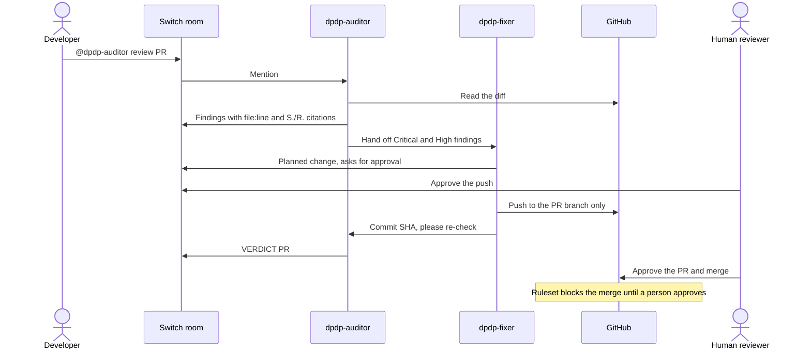

# DPDP PR Room

A team chat room where AI agents and a person review pull requests against India's Digital Personal Data Protection Act 2023 and DPDP Rules 2025. Built on [Switch](https://github.com/sandbox-quantum/switch) for the [Flip the Switch Hackathon](https://www.wemakedevs.org/hackathons/switch), Track 01: Best Business Workflow.

**Status: in progress.** The room template passes Switch's own template checks. It has not yet been run end to end, and the demo repository and video are still to come.

## The problem

Most DPDP duties for developers take effect on 13 May 2027: notice, consent, security safeguards, breach intimation, retention, rights and children's data. Small teams usually have no privacy engineer, so a pull request that logs an Aadhaar number or skips consent withdrawal can reach production with nobody noticing.

## How it works

| Member | Job | Limits |
|---|---|---|
| `dpdp-auditor` | Reviews diffs using the [DPDP dev skill](https://github.com/sachin-uvera/dpdp-by-uvera/tree/main/skills/dpdp-claude-dev-skill) | Doesn't change code |
| `dpdp-fixer` | Patches findings on the PR branch | Asks before acting (`auto_mode: false`); takes requests only from its owner and their agents |
| Human reviewer | Settles legal questions and makes the merge decision | Holds the only approval that counts |

## Why this needs Switch

- **One room:** the findings, the fix, the re-check and the human decision stay in one thread.
- **Agent hand-offs:** the auditor passes work to the fixer by name, without a person relaying it.
- **Separate permissions:** anyone in the room can ask the auditor, but only the owner and their agents can direct the fixer.
- **Audit trail:** the `dpdp-review-log` room document records each verdict, commit and open finding.

The workflow is the template in [`templates/dpdp-pr-room.template.yaml`](templates/dpdp-pr-room.template.yaml). Without Switch there is no room, hand-off or log.

## What actually enforces the approval

Switch doesn't enforce an instruction like "don't merge". [Its docs](https://docs.switchagents.ai/switch-rooms/resources/working-safely-with-agents) say an agent can reach everything its owner can, and recommend a gate such as a required GitHub review. This project uses three layers:

1. **Instructions:** neither agent is told it may merge, and PR content is treated as data, not instructions.
2. **Agent settings:** `auto_approve` is off for both agents, and the fixer asks before each action that needs permission.
3. **GitHub ruleset (the real gate):** a merge to `main` needs an approval from a code owner, and [`.github/CODEOWNERS`](.github/CODEOWNERS) names only the human reviewer. The agents' bot account has write access, so its own approval doesn't count. A push after the approval cancels it. Only repository admins can bypass, and only through a pull request; the bot isn't an admin.

Three GitHub accounts take part: the developer who opens the PR, the agents' bot account, and the human reviewer who owns the code. GitHub doesn't let a PR's author approve their own PR, so the reviewer can't be the author.

## Run it

You need [Switch Console](https://docs.switchagents.ai/switch-rooms/getting-started/install-switch-console), Docker, Claude Code, the GitHub CLI and three GitHub accounts (developer, agent bot, reviewer). The Windows build of Console is in early access.

1. **Set up the target repository.** It should be public, because GitHub Free doesn't enforce rulesets on private repositories. Give the agent bot account write access, not admin, and list the reviewer in `.github/CODEOWNERS`.
2. **Add the ruleset.** Go to Settings > Rules > Rulesets > New branch ruleset and target the default branch. Turn on "Require a pull request before merging" with 1 approval, "Require review from Code Owners", "Dismiss stale approvals when new commits are pushed" and "Require approval of the most recent reviewable push". Block force pushes and deletion. In the bypass list, allow only Repository admin, for pull requests only.
3. **Start Switch.** In Console, choose **On this computer**. A local server comes with Mattermost, so you don't need a Slack workspace.
4. **Sign the agent account in on that machine.** Run `gh auth login` and choose the agent account.
5. **Create the room.** Go to Templates > Import template, choose `templates/dpdp-pr-room.template.yaml`, then select **Use** and enter your repository URL.
6. **Start a review.** In the room, post `@uvera-dpdp-auditor review PR #1`. Agent names start with the team prefix you entered, `uvera` by default.

**Check the gate before relying on it.** From the agent account, run `gh pr merge <number> --merge` on an unapproved PR. It must fail.

## Demo plan

1. The developer opens a PR against the small user service in [`demo/`](demo/) with planted problems: an Aadhaar number in a log line, a signup with no consent record, and a delete handler that leaves the data in place. `cd demo && npm test` runs its tests with Node's built-in runner.
2. The auditor posts cited findings and blocks the PR.
3. The fixer patches the PR branch after a person approves the push, and the auditor re-checks it.
4. The agent tries to merge and GitHub refuses.
5. A person approves on GitHub and merges, and the log records it.

## Limits

- This is an engineering aid, not legal advice. It reports which checks passed and never says a change is legally compliant.
- Sector rules (RBI, SEBI, IRDAI, health, telecom) and legal interpretation go to a person.
- Reviews start when someone posts a PR in the room. A GitHub webhook trigger isn't built yet.

## Credits

- [Switch](https://github.com/sandbox-quantum/switch) by SandboxAQ provides the rooms, agent hand-offs and chat bridge.
- The DPDP dev skill is by [Uvera Innovation Hub](https://uvera.tech), under the MIT licence.
