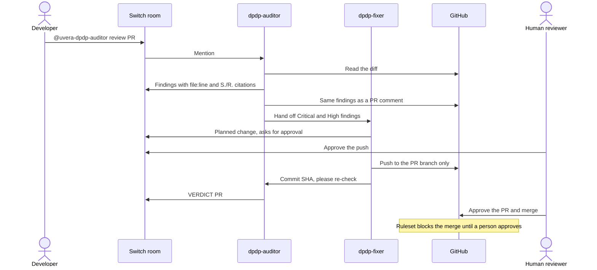

# DPDP PR Room

A team chat room where AI agents and a person review pull requests against India's Digital Personal Data Protection Act 2023 and DPDP Rules 2025. Built on [Switch](https://github.com/sandbox-quantum/switch) for the [Flip the Switch Hackathon](https://www.wemakedevs.org/hackathons/switch), Track 01: Best Business Workflow.

**Status: working end to end** on Switch Console 0.40.1 for Windows with a local Switch server and Mattermost. The auditor has reviewed a real pull request ([#1](https://github.com/sachin-uvera/dpdp-pr-room/pull/1)) and handed its findings to the fixer.

**Demo video:** _link to come_

## The problem

Most DPDP duties for developers take effect on 13 May 2027: notice, consent, security safeguards, breach intimation, retention, rights and children's data. Small teams usually have no privacy engineer, so a pull request that logs an Aadhaar number or skips consent withdrawal can reach production with nobody noticing.

## How it works



| Member | Job | Limits |
|---|---|---|
| `dpdp-auditor` | Reviews diffs using the [DPDP dev skill](https://github.com/sachin-uvera/dpdp-by-uvera/tree/main/skills/dpdp-claude-dev-skill) | Doesn't change code |
| `dpdp-fixer` | Patches findings on the PR branch | Asks before acting (`auto_mode: false`); takes requests only from its owner and their agents |
| Human reviewer | Settles legal questions and makes the merge decision | Holds the only approval that counts |

## What a review looks like

This is the auditor's review of [PR #5](https://github.com/sachin-uvera/dpdp-pr-room/pull/5), which adds KYC signup and account deletion to the [`demo/`](demo/) service. The PR's own tests pass. "S." is a section of the DPDP Act 2023; "R." is a rule of the DPDP Rules 2025.

| # | Finding | Evidence | Law | Severity |
|---|---|---|---|---|
| F1 | The full signup input, including Aadhaar, phone and email, is logged raw, skipping the masking logger | `users.js:17` | S.8(5), R.6(1)(a) | Critical |
| F2 | The Aadhaar number is stored in plaintext and returned in full | `users.js:21, 35` | S.8(5), R.6(1)(a) | Critical |
| F3 | Marketing consent is on when the user gave no answer | `users.js:22` | S.6(1) | High |
| F4 | Deletion only sets `deletedAt`; all personal data stays | `users.js:26-31` | S.8(7)(a), S.12(3) | High |
| F5 | No consent record for marketing | `users.js:22` | S.6(10) | Medium |
| F6 | Phone number collected with no stated purpose | `users.js:20` | S.6(1) | Medium |

Every finding also names the fix. The auditor handed F1–F4 to the fixer and raised four questions for the human reviewer: whether the service may do Aadhaar-based KYC under the Aadhaar Act, whether a law such as PMLA requires keeping KYC records after deletion, whether under-18s can sign up (S.9), and where the S.5(1)/R.3 notice is shown.

The fixer's commit `f29797f` logged only the id, kept just the last 4 Aadhaar digits, made opt-in explicit and removed personal data on delete. On re-review, the auditor closed F1–F4, left F5 and F6 open for a follow-up, and ended with `VERDICT PR #5: READY FOR HUMAN REVIEW`.

Three problems were planted: the log line, the default opt-in and the soft delete. The auditor also found F2, F5 and F6.

## Why this needs Switch

A GitHub Action could run the same review and comment on the PR. The auditor here does that too. What an Action can't do is the part where people and agents work together while the fix is happening:

| In this room | What Switch provides | With a GitHub Action alone |
|---|---|---|
| The fixer asks before each command, and a person clicks **Allow once** in chat | Permission requests from a running agent, answered in chat | The job runs start to finish; nobody can approve a step midway |
| The auditor hands F1–F4 to the fixer by name, and re-checks its commit | Agents addressing each other in one room | Separate jobs with no conversation; a person relays the results |
| Anyone in the room can ask the auditor, but only the owner and their agents can direct the fixer | Per-agent `addressing` | Whoever can push or comment triggers everything |
| The auditor asks the reviewer about Aadhaar KYC and PMLA retention, and the answer shapes the fix | A person in the same thread as the agents | Questions sit in a PR comment until someone reruns the job |
| `dpdp-audit-log` keeps one entry per verdict, commit and decision | Room documents the agents write | Logs scattered across workflow runs |
| The same room works on Mattermost, Slack or Discord | The `bridge` parameter in the template | A different integration per chat app |

The workflow is the template in [`templates/dpdp-pr-room.template.yaml`](templates/dpdp-pr-room.template.yaml). Take Switch away and you lose the live approvals, the hand-off and the shared thread. What's left is a review bot.

## What actually enforces the approval

Switch doesn't enforce an instruction like "don't merge". [Its docs](https://docs.switchagents.ai/switch-rooms/resources/working-safely-with-agents) say an agent can reach everything its owner can, and recommend a gate such as a required GitHub review. This project uses three layers:

1. **Instructions:** neither agent is told it may merge, and PR content is treated as data, not instructions.
2. **Agent settings:** `auto_approve` is off for both agents, and the fixer asks before each action that needs permission.
3. **GitHub ruleset (the real gate):** a merge to `main` needs an approval from a code owner, and [`.github/CODEOWNERS`](.github/CODEOWNERS) names only the human reviewer. The agents' bot account has write access, so its own approval doesn't count. A push after the approval cancels it. Only repository admins can bypass, and only through a pull request; the bot isn't an admin.

Three GitHub accounts take part: the developer who opens the PR, the agents' bot account, and the human reviewer who owns the code. GitHub doesn't let a PR's author approve their own PR, so the reviewer can't be the author.

**The admin bypass is a person's choice, and it's logged.** On a PR page, an admin sees "Merge without waiting for requirements". That's how PR #1 was merged by mistake, with its findings unfixed. GitHub recorded it as a bypass by the admin under Settings > Rules > Insights, and it was reverted in a follow-up PR. The bot can't do this, because it isn't an admin. If you want no bypass at all, empty the bypass list and add a second code owner to approve maintenance PRs.

## Run it

You need [Switch Console](https://docs.switchagents.ai/switch-rooms/getting-started/install-switch-console), Docker, Claude Code, the GitHub CLI and three GitHub accounts (developer, agent bot, reviewer). The Windows build of Console is in early access.

1. **Set up the target repository.** It should be public, because GitHub Free doesn't enforce rulesets on private repositories. Give the agent bot account write access, not admin, and list the reviewer in `.github/CODEOWNERS`.
2. **Add the ruleset.** Go to Settings > Rules > Rulesets > New branch ruleset and target the default branch. Turn on "Require a pull request before merging" with 1 approval, "Require review from Code Owners", "Dismiss stale approvals when new commits are pushed" and "Require approval of the most recent reviewable push". Block force pushes and deletion. In the bypass list, allow only Repository admin, for pull requests only.
3. **Start Switch.** In Console, choose **On this computer**. A local server comes with Mattermost, so you don't need a Slack workspace.
4. **Sign the agent account in on that machine.** Run `gh auth login`, sign in as the agent bot account, then `gh auth switch --user <bot>`. In each agent's working directory, clone the repository and make git use the bot's `gh` login instead of a saved one:

   ```sh
   git config credential.helper ""
   git config --add credential.helper '!gh auth git-credential'
   git config credential.https://github.com.username <bot>
   git config user.name <bot>
   ```
5. **Create the room.** Go to Templates > Import template, choose `templates/dpdp-pr-room.template.yaml`, then select **Use** and enter your repository URL.
6. **Start a review.** In the room, post `@uvera-dpdp-auditor review PR #1`. Agent names start with the team prefix you entered, `uvera` by default.

**Check the gate before relying on it.** From the agent account, run `gh pr merge <number> --merge` on an unapproved PR. It must fail. On [PR #5](https://github.com/sachin-uvera/dpdp-pr-room/pull/5), after the fixer's push and the auditor's "ready for human review" verdict, the bot got:

```
$ gh pr merge 5 --merge
X Pull request sachin-uvera/dpdp-pr-room#5 is not mergeable: the base branch policy prohibits the merge.

$ gh pr merge 5 --merge --admin
GraphQL: Repository rule violations found
Waiting on code owner review from sachin-uvera.
```

The human reviewer then approved and merged it with the normal button. GitHub's ruleset log (Settings > Rules > Insights) shows the bot's attempt as **fail** and the reviewer's merge as **pass**.

## Running Switch Console on Windows

Console's Windows build is in early access. These are the problems we hit with 0.40.1 and how this project works around them.

- **Use a `machine` param, not `location`.** On a server that manages agents, Console stores your computer's machine id in a `location` param and then treats that id as an SSH host, so it finds no agent CLI. A `machine` param resolves to "This computer".
- **Name the provider in the template.** On Windows, Console offers no local choices for a `provider` param ("SDK sessions require a POSIX SSH execution host"). The template sets `provider: claude` on each agent.
- **Check before retrying Create all.** Console can time out ("Could not reach the server") while the server is still creating the agents and the room. Look in Your Rooms before running it again.
- **Let the agent create its own log.** Only a room document's creator can edit it, so a document the template creates is read-only for the agents.
- **Stop the local server before restarting Windows.** A forced shutdown killed the bundled Postgres and left the server stopped after reboot.

## Demo

1. The developer opens a PR against the small user service in [`demo/`](demo/) with planted problems: an Aadhaar number in a log line, a signup with no consent record, and a delete handler that leaves the data in place. `cd demo && npm test` runs its tests with Node's built-in runner.
2. The auditor posts cited findings and blocks the PR.
3. The fixer patches the PR branch after a person approves the push, and the auditor re-checks it.
4. The agent tries to merge and GitHub refuses.
5. A person approves on GitHub and merges, and the log records it.

<!-- Screenshots: add docs/img/findings.png, docs/img/merge-refused.png and docs/img/audit-log.png after recording -->


## Limits

- This is an engineering aid, not legal advice. It reports which checks passed and never says a change is legally compliant.
- Sector rules (RBI, SEBI, IRDAI, health, telecom) and legal interpretation go to a person.
- Reviews start when someone posts a PR in the room. A GitHub webhook trigger isn't built yet.

## Credits

- [Switch](https://github.com/sandbox-quantum/switch) by SandboxAQ provides the rooms, agent hand-offs and chat bridge.
- The DPDP dev skill is by [Uvera Innovation Hub](https://uvera.tech), under the MIT licence. It existed before this hackathon (last updated 29 September 2026) and is used here unchanged, as the auditor's reference. Everything in this repository was built for the hackathon.
