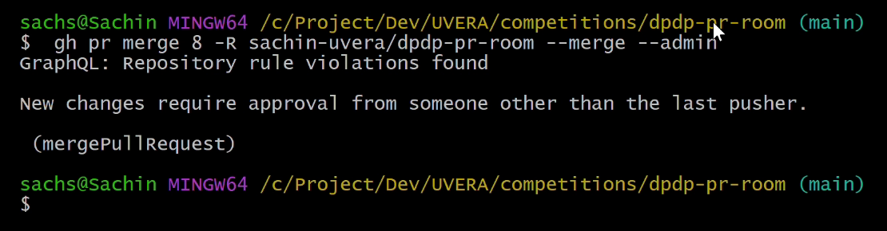
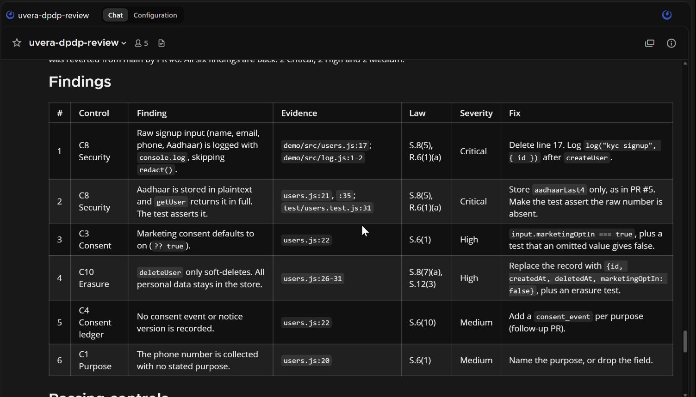

# My AI agents aren't allowed to merge, and GitHub makes sure of it

_Building a DPDP review room on Switch for the Flip the Switch Hackathon_

Most of India's Digital Personal Data Protection duties for developers apply from 13 May 2027: notice, consent, security safeguards, retention, erasure and children's data. Small teams rarely have a privacy engineer. A pull request that logs an Aadhaar number, or turns marketing consent on by default, can reach production without anyone noticing.

So I built **DPDP PR Room**: a team chat room where two AI agents and a person review pull requests against the DPDP Act 2023 and DPDP Rules 2025. It runs on [Switch](https://github.com/sandbox-quantum/switch), and the code is at [sachin-uvera/dpdp-pr-room](https://github.com/sachin-uvera/dpdp-pr-room).

**Watch the demo (2:15):** [youtu.be/WmHptQJFNyQ](https://youtu.be/WmHptQJFNyQ)

## Who is in the room

- **`dpdp-auditor`** reads the PR's diff, reviews it with our open-source [DPDP dev skill](https://github.com/sachin-uvera/dpdp-by-uvera), and posts findings with file and line, the DPDP section or rule, severity and a fix, in the room and as a comment on the PR. It never changes code.
- **`dpdp-fixer`** takes the Critical and High findings, says what it will change, waits for a person to approve, and pushes the smallest fix to the PR's branch. It never merges.
- **A person** settles anything that needs legal judgment and makes the merge decision.

When a PR changes the app's code, a small watcher posts `@uvera-dpdp-auditor review PR #7` in the room. Everything after that happens in one thread: findings, hand-off, fix, re-check and decision. The auditor also keeps a room document, `dpdp-audit-log`, with one entry per verdict.

## A prompt is not a gate

Early on I planned to write "never merge" in the agents' instructions and call it done. Switch's own [guidance on working safely with agents](https://docs.switchagents.ai/switch-rooms/resources/working-safely-with-agents) puts it bluntly: an agent can reach everything its owner can, and Switch doesn't enforce an instruction like that. If the agents run with my GitHub login, they can merge whatever I can merge.

So the instruction is the first layer, not the last. The real gate lives in GitHub:

1. **The agents get their own account.** A separate bot account with write access, never admin. Each agent's working folder is set so git and `gh` act as the bot, not as me.
2. **Only the code owner's approval counts.** `.github/CODEOWNERS` names the human reviewer. A ruleset on `main` requires a pull request, one approval from a code owner, and a fresh approval after any new push.
3. **Nobody force-pushes or bypasses quietly.** Force pushes and branch deletion are blocked. Only repository admins can bypass, and only through a pull request.

One detail surprised me. A plain "1 approval required" rule is not enough. Any account with write access can approve, including the bot, so the bot could approve a PR someone else wrote and then merge it. Requiring a code owner's review closes that hole. It also means three accounts take part: the developer who opens the PR, the bot, and the reviewer. GitHub doesn't let a PR's author approve their own PR.

Then I tested it. In a rehearsal, the fixer pushed its fix as the bot, and the auditor marked the PR ready for human review. Then, as the bot, I tried to merge it:

```
$ gh pr merge 5 --merge
X Pull request sachin-uvera/dpdp-pr-room#5 is not mergeable: the base branch policy prohibits the merge.

$ gh pr merge 5 --merge --admin
GraphQL: Repository rule violations found
Waiting on code owner review from sachin-uvera.
```



GitHub names the person it's waiting for. I approved as code owner, merged with the normal button, and the ruleset log recorded the bot's attempt as a fail and my merge as a pass.

## What the auditor found

To test it, I planted three problems in a small Node user service: a signup that writes the whole request to the log, marketing opt-in on by default, and a "delete" that only sets `deletedAt`. The PR's tests pass, because tests don't check for privacy problems.

The auditor's verdict ("S." is a section of the DPDP Act, "R." a rule of the DPDP Rules):

> **BLOCK** · F1 Critical: raw Aadhaar, phone and email logged (S.8(5), R.6(1)(a)) · F2 Critical: plaintext Aadhaar stored and returned in full (S.8(5), R.6(1)(a)) · F3 High: marketing consent on by default (S.6(1)) · F4 High: soft delete keeps personal data (S.8(7)(a), S.12(3)) · F5 Medium: no consent record (S.6(10)) · F6 Medium: phone collected with no stated purpose (S.6(1))



It found all three planted problems and three I hadn't planted. It handed F1–F4 to the fixer and left the Medium findings, and the merge, to a person. It also asked me four questions it couldn't answer itself: whether the service may do Aadhaar-based KYC at all, whether a law such as PMLA requires keeping KYC records after deletion, whether under-18s can sign up, and where the privacy notice is shown. Those are legal calls, and the room is where a person answers them.

## Running Switch Console on Windows

Console's Windows build is in early access, and I hit most of its rough edges in one evening. If you're on Windows, these will save you time:

- **Use a `machine` param, not `location`.** On a server that manages agents, a `location` param stores your machine's id, and Console then tries to reach that id over SSH. The form found no agent CLI, and Create stayed disabled.
- **Name the provider in the template.** On Windows, Console offers no local choices for a `provider` param. Writing `provider: claude` on each agent fixed it.
- **Check before retrying Create all.** Console timed out with "Could not reach the server", but the server carried on and finished creating the room about 25 seconds later.
- **Let agents create the documents they write to.** Only a room document's creator can edit it, so the log my template created was read-only for the auditor. Now the auditor creates its own.
- **Stop the local server before restarting Windows.** A forced restart killed the bundled Postgres, and the server stayed down after reboot.

Reading Console's logs and source, which ships as plain JavaScript in `app.asar`, found each of these faster than guessing.

## What's next

Nobody has to ask for a review. A small watcher script polls GitHub every minute. When a new PR changes the app's code, it posts `@uvera-dpdp-auditor review PR #N` into the room through a Mattermost incoming webhook, and Switch hands it to the auditor like any other message. A local Switch server has no public address for GitHub webhooks, so polling is the simple fix. Next is narrowing the trigger to the files that handle personal data, and running the room on a hosted Switch server for a whole team.

This is an engineering aid, not legal advice. The auditor says which checks passed and never calls a change compliant. Sector rules and legal interpretation stay with a person.

- Code: [github.com/sachin-uvera/dpdp-pr-room](https://github.com/sachin-uvera/dpdp-pr-room)
- DPDP skill: [github.com/sachin-uvera/dpdp-by-uvera](https://github.com/sachin-uvera/dpdp-by-uvera)
- Demo video (2:15): [youtu.be/WmHptQJFNyQ](https://youtu.be/WmHptQJFNyQ)
